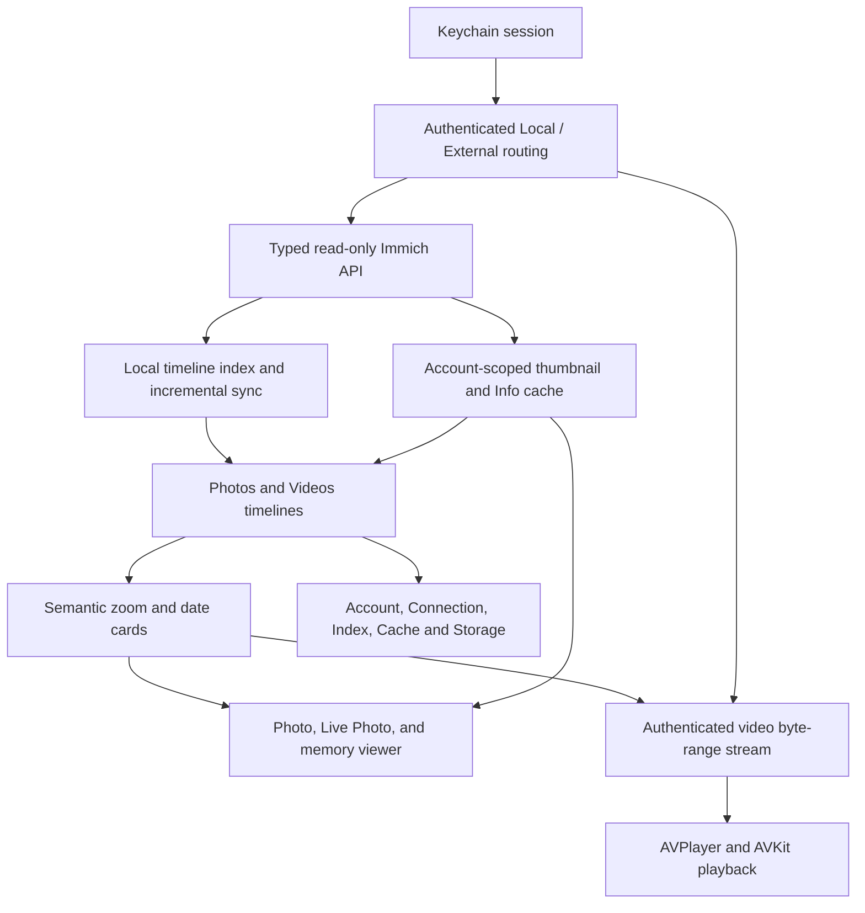

# Contributing to Remmich

The [README](README.md) describes the available features, current limitations, and milestone progress. This guide covers how to build the app and how the project is organized.

## Requirements

- Xcode 27 or later; the current source has been compiled with Xcode 27.2.
- The app uses Swift 6 language mode (`SWIFT_VERSION = 6.0`). The local API package requires Swift tools 6.2 or later; the verified Xcode 27.2 toolchain uses Swift 6.4.2.
- SwiftFormat matching [.swiftformat-version](.swiftformat-version). The [build workflow](.github/workflows/build.yml) contains the pinned download and checksum-verification steps.
- To run the app on a device, iOS/iPadOS 26.6 or later and an account on your Immich server.

Swift packages resolve through Xcode. The local API package's generator and runtime dependencies are pinned in [Package.swift](Packages/ImmichAPI/Package.swift); schema provenance is recorded [alongside the package](Packages/ImmichAPI/SCHEMA-PROVENANCE.md).

## Build and run

```bash
git clone https://github.com/Ender-Wang/Remmich.git
cd Remmich
open Remmich.xcodeproj
```

1. Install the pinned SwiftFormat version and let Xcode resolve the packages. Xcode may ask you to trust the Swift OpenAPI Generator build-tool plugin.
2. Select the **Remmich** scheme and your device, choose your signing team, and use a unique bundle identifier if your team requires one.
3. Build and run. Sign in with your Immich server address and credentials, then configure Local and External addresses in **Profile → Connection** if needed.

The active Personal Team configuration uses endpoint validation rather than requiring Wi-Fi-information entitlement access. It checks the current endpoint first, then saved alternatives in profile order, using an authenticated identity check. True SSID matching requires an appropriately provisioned paid-team entitlement; the capability is recorded in [Remmich.entitlements](Remmich/Remmich.entitlements).

## Architecture

### Data flow



The generated API client is wrapped by [ImmichServiceAdapter](Remmich/Infrastructure/Immich/ImmichServiceAdapter.swift) and the feature-facing [read-only service protocols](Remmich/Domain/Protocols/ReadOnlyServices.swift). Account restoration and route changes are coordinated from [AppSessionController](Remmich/App/AppSessionController.swift).

The timeline index and paired thumbnail/Info cache are local, account-scoped stores. Video playback uses [AuthenticatedVideoStreamSource](Remmich/Infrastructure/Media/AuthenticatedVideoStreamSource.swift) with one viewer-owned [VideoPlaybackSession](Remmich/Features/Shared/AssetViewer/VideoPlaybackSession.swift). It streams the selected video; persistent original downloads and export actions remain planned work.

### Source layout

```text
Remmich/
├── App/                    # Entry point, session lifecycle, native tab shell
├── Domain/                 # Models, service protocols, timeline/index/navigation policies
├── Infrastructure/         # Immich adapters, networking, Keychain, storage, media
├── Features/
│   ├── Photos/             # Timeline store, semantic zoom, date cards and range browsing
│   ├── Shared/AssetViewer/ # Photo, Live Photo, and memory viewers; video playback
│   ├── LibraryIndex/       # Index and offline-cache coordination
│   ├── Settings/           # Account, connection, index/cache UI and app-icon selection
│   └── ...                 # Onboarding, Videos, Albums, Library, Search
├── DesignSystem/           # Shared surfaces, loading states, branding and gestures
├── Assets.xcassets/        # Native images and generated branding layers
└── Resources/              # Icon Composer artwork and branding geometry
Packages/ImmichAPI/         # Pinned OpenAPI schema, generated client, package tests
RemmichTests/               # App logic and hosted UIKit regression tests
Scripts/                   # Schema update and artwork generation
.github/workflows/         # Build once, then test those products
```

### Key patterns

| Pattern | What to preserve |
| --- | --- |
| Read-only boundary | Feature services read Immich content. Upload, edit, archive, favorite, and delete operations stay outside the product scope. Future export actions operate on local copies. |
| Swift concurrency | The app uses Swift 6 with `MainActor` as the default isolation. Models, actors, and framework callbacks use explicit isolation where needed; preserve the actual executor and cancellation contract when changing asynchronous work. |
| Stable asset identity | Viewer selection, semantic-zoom focus, and scroll restoration use asset identity. Video playback owns the exact selected video rather than switching through the photo pager. |
| Gesture ownership | Root page swipes, left-edge Back, media paging, zoom, and video scrubbing have separate ownership rules. Preserve gesture cancellation and nested Back history. |
| Local storage ownership | Account-scoped index, thumbnail/Info cache, transient previews, and playback-session resources have distinct lifecycles. Clearing one cache must not erase unrelated local data. |
| Smooth semantic zoom | Metadata drives the transition between photos and date cards; network or image-decode completion does not gate the gesture. Preserve the focused asset and viewport position. |
| Logo rendering | Capture the changing elapsed phase and pose before constructing `Canvas` in each `TimelineView` update. Reading the clock only inside the `Canvas` renderer can leave its display list cached. Rendering pauses when hidden or in the background; Reduce Motion uses static artwork. |
| Product documentation | Keep the README feature and milestone summaries current, and describe implementation details here. Distinguish implemented work from pending device acceptance and unfinished features. |

## Tests and formatting

Start with the tests affected by the change. Use two build jobs and run one CPU-intensive build/test command at a time.

Compile the app and test bundles for a generic iOS device:

```bash
xcodebuild build-for-testing \
  -project Remmich.xcodeproj \
  -scheme Remmich \
  -destination 'generic/platform=iOS' \
  -jobs 2 \
  -quiet \
  -parallel-testing-enabled NO \
  COMPILER_INDEX_STORE_ENABLE=NO \
  CODE_SIGNING_ALLOWED=NO
```

This compiles test products; it does not execute the tests. Run relevant app tests in Xcode, and verify media behavior, gestures, rotation, and accessibility on a physical device. The [CI build workflow](.github/workflows/build.yml) produces one set of app/test products; the [test workflow](.github/workflows/test.yml) runs the package and app-logic tests against that build's revision.

Run the API package tests with:

```bash
swift test --package-path Packages/ImmichAPI --jobs 2
```

The Xcode project checks formatting before compilation. For a focused formatting check, pass the changed Swift files explicitly:

```bash
swiftformat --lint --config .swiftformat path/to/ChangedFile.swift
```

## Schema and artwork updates

Refresh the pinned schema from a sibling Immich checkout, or provide a schema path:

```bash
Scripts/update-immich-schema.sh
Scripts/update-immich-schema.sh path/to/immich-openapi-specs.json
```

Review the schema change and update [its provenance record](Packages/ImmichAPI/SCHEMA-PROVENANCE.md) together. Let the pinned OpenAPI Generator plugin generate the client from that input.

Generate native branding layers from the committed Icon Composer SVGs:

```bash
python3 Scripts/generate-brand-artwork.py
```

Artwork generation requires librsvg's `rsvg-convert`. Review the generated layers and geometry alongside the SVG source. Logo credits appear below the logo in the [README header](README.md).

## Proposing a change

Use the [milestone table](README.md#milestones) to understand current scope. Keep changes focused, explain the user-visible behavior, and state the tests and device checks performed. Record remaining verification honestly. Update the README when available features, limitations, or milestone status change; update this guide when architecture or developer workflows change.
