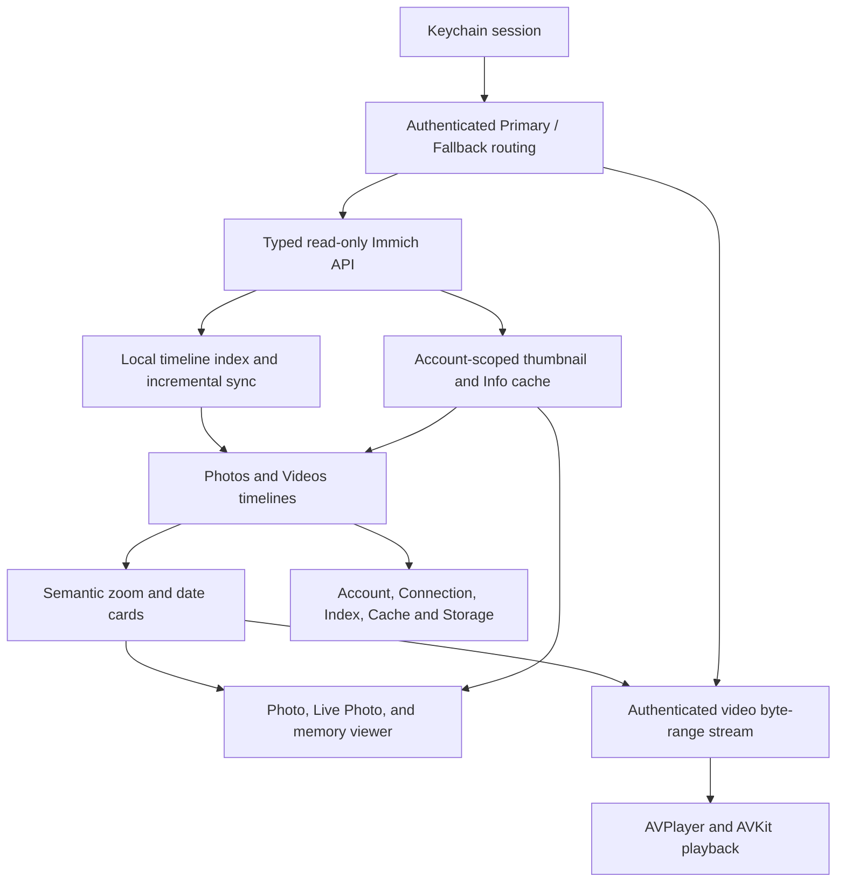

# Contributing to Remmich

The [README](README.md) describes the available features, current limitations, and milestone progress. This guide covers how to build the app and how the project is organized.

## Requirements

- Xcode 27 or later; the current source has been compiled with Xcode 27.2.
- The app uses Swift 6 language mode (`SWIFT_VERSION = 6.0`). The local API package requires Swift tools 6.2 or later; the verified Xcode 27.2 toolchain uses Swift 6.4.2.
- SwiftFormat matching [.swiftformat-version](.swiftformat-version). The [build workflow](.github/workflows/build.yml) contains the pinned download and checksum-verification steps.
- To run the app on a device, iOS/iPadOS 26.6 or later and an account on your Immich server.

Swift packages resolve through Xcode. The local API package's generator and runtime dependencies are pinned in [Package.swift](Packages/ImmichAPI/Package.swift); schema provenance is recorded [alongside the package](Packages/ImmichAPI/SCHEMA-PROVENANCE.md).

## Build and run

```bash
git clone https://github.com/Ender-Wang/Remmich.git
cd Remmich
open Remmich.xcodeproj
```

1. Install the pinned SwiftFormat version and let Xcode resolve the packages. Xcode may ask you to trust the Swift OpenAPI Generator build-tool plugin.
2. Select the **Remmich** scheme and your device, choose your signing team, and use a unique bundle identifier if your team requires one.
3. Build and run. Sign in with your Immich server address and credentials, then configure a Primary address and optional Fallback addresses in **Profile → Connection** if needed.

Connection selection checks Primary first, then Fallback addresses in order, using authenticated user-ID validation. It does not require Wi-Fi-name access or a location permission. Connection displays omit the trailing `/api` while internal endpoints retain it. A separate unauthenticated `/server/ping` probe measures HTTP response time only while Connection is visible and the app is active; probe rounds do not overlap or switch routes. The initial label stays `Checking…` until a result arrives; state changes fade, and response digits roll independently of the steady `ms` suffix. Reduce Motion disables these animations.

Without saved connection settings, the authenticated login URL is the implicit Primary address. Saved profiles retain their ordered Primary/Fallback classification, including login through a known fallback URL. There is no separate Direct route type or validation path, and the implicit default does not overwrite saved settings.

Verified endpoint aliases share a stable account cache identity, independent of the current network URL. After successful login, SQLite resolves a retained identity through an exact endpoint/user-ID match or one unambiguous verified alias. Email alone is never an identity key. Saving a profile authenticates additional candidates before recording aliases; unreachable or different-account endpoints are not associated. Ordinary logout retains aliases and cached data; deleting an account's local data removes its aliases, SQL records, and thumbnail namespace. Old address-profile keys are not adopted. The current schema includes the account-scoped alias table.

Connection profiles, automatic-cache preferences, manual-cache intent, and Index/cache pause choices belong to that same account identity. Signing out while keeping data preserves those choices for the account's next login; another account loads only its own saved state. Session teardown clears runtime statistics, routing, metadata readers, and viewer state before adopting a new owner. Delayed metadata responses and transfer configuration must still match the requesting owner and generation. Legacy global connection/cache preference keys have no known owner and are not adopted. The physical SQLite database size includes all stored accounts; asset and derivative inventories are account-specific.

Manage saved sessions and retained local data under **Profile → Account → Accounts**. The list joins Keychain credentials and SQL inventories by verified account namespace, including the current account and data-only accounts that need sign-in. The current row samples in-memory Index/cache progress once per second while visible; inactive rows use accepted-generation SQL aggregates and saved pause/manual-cache intent. Thumbnail inventory excludes unverified, orphaned, and stale-revision records; cache completion requires both a thumbnail and metadata. Storage labels show thumbnail bytes rather than assigning shared SQLite bytes to an account. Local-data deletion preserves saved credentials, with confirmation and live progress; current-account deletion remains a sign-out choice.

Current, Switch, and Sign in share the account row's trailing action column. Current is plain text in the Connection icon's green; Switch and Sign in use compact glass capsules. Inactive rows expose a trailing **Clear Data** glass button with red text for their index, thumbnails, and metadata. **Sign Out** is available only for the active account. Clearing another account's offline data retains its saved sign-in.

`KeychainSessionStore` keeps independent `saved-session-<namespace>` records alongside the existing `active-session` payload. Restoring an existing active session registers its scoped record. Corrupt records are isolated; protected-store access failures retain credentials. A switch pins the target credential and saves the active owner before clearing outgoing runtime readers and transfer ownership, then restores the incoming account through the normal guarded bootstrap and authenticated route evaluation. Switching never calls Immich logout. Route callbacks are invalidated before credential selection, and credential deletion identifies its intended namespace. Explicit sign-out revokes only the selected session using its own endpoint/token. Add account suspends the outgoing runtime while retaining a return session for Cancel; successful authentication refreshes a saved identity only through verified endpoint/user matches, never email.

Schema 7 retains display name/email in the account's scope, separately from its Keychain credentials. Authentication and session restoration refresh this metadata; signing out while keeping local data retains it, and deleting that account's local data removes it. This testing build creates the current database schema directly and accepts only that version; older databases require fresh local app data. There are no schema-upgrade, historical backfill, or automatic-delete paths. `AccountSignOutButton` attaches a SwiftUI confirmation popover to each actual button before row-wide layout modifiers. Its content uses SwiftUI controls rather than an alert controller; Cancel/outside dismissal changes only presentation state.

## Architecture

### Data flow



The generated API client is wrapped by [ImmichServiceAdapter](Remmich/Infrastructure/Immich/ImmichServiceAdapter.swift) and the feature-facing [read-only service protocols](Remmich/Domain/Protocols/ReadOnlyServices.swift). Account restoration and route changes are coordinated from [AppSessionController](Remmich/App/AppSessionController.swift).

The timeline index and paired thumbnail/Info cache are local, account-scoped stores. Video playback uses [AuthenticatedVideoStreamSource](Remmich/Infrastructure/Media/AuthenticatedVideoStreamSource.swift) with one viewer-owned [VideoPlaybackSession](Remmich/Features/Shared/AssetViewer/VideoPlaybackSession.swift). It streams the selected video; persistent original downloads and export actions remain planned work.

Timeline thumbnails can read both managed offline files and Nuke's account-scoped memory/disk cache before a connection route is validated. When no active route exists and no managed file matches, the saved account URL constructs a thumbnail request with `returnCacheDataDontLoad`; it cannot start a network fetch. Route activation removes that option, which NukeUI observes even when the URL and image identity stay unchanged, so cache misses retry automatically. A cache-only miss keeps the loading placeholder. Preview/original requests retain their existing route requirements. [MediaOfflineThumbnailTests](RemmichTests/MediaOfflineThumbnailTests.swift) covers cold disk-cache loading, zero-network misses followed by same-URL activation, and account isolation; these UIKit fixtures were source-checked locally but not executed. Cached thumbnail display during a fully disconnected cold launch was manually verified on a physical device.

### Landing and sign-in

[OnboardingView](Remmich/Features/Onboarding/OnboardingView.swift) uses the profile's animated branding, green connection and blue account accents, and a native glass form. An adaptive layout keeps branding above the form in portrait and beside it in landscape, with scrolling for the keyboard and larger text. [RootView](Remmich/App/RootView.swift) keeps a single onboarding view across server checking, credentials, sign-in progress, and failure so field values and logo motion survive those transitions. Checking uses that mounted branding rather than a second full-screen loader. Server validation, HTTP confirmation, credential storage, and successful library preparation remain owned by `AppSessionController`; OAuth remains unsupported.

An empty server-address field selects `https://demo.immich.app`. After validation, only that HTTPS origin's credential screen is prefilled with the public demo account; sign-in still requires a user action. The demo's login notice is omitted. Custom-server notices retain the limited native HTML text renderer for line breaks, emphasis, warning text, entities, lists, and HTTP(S) links. Script and embedded active content are omitted; JavaScript links become inactive labels. The renderer loads no web resources and does not extract credentials or submit sign-in.

Before Keychain restoration establishes an authenticated account, startup shows the system background and loading logo. Native tab placeholders are reserved for an authenticated library being prepared. Signed-out foreground entry does not wait for native transfer-session restoration.

After foreground restoration establishes the account and local media/timeline scope, local library bootstrap and authenticated route validation run concurrently. The existing owned foreground-preparation task publishes local readiness independently of network latency. Route-outcome application, activation, and automatic sync wait for that task; generation, cancellation, and account checks run again after the wait. Account invalidation cancels the local job, and restoration awaits and clears its captured task before returning. Background restoration retains its existing ordering. Session fixtures cover local readiness during suspended validation and rejection of a late validation result after sign-out. A physical-device cold-launch capture verified validation overlapping bootstrap and waiting for local readiness before activation; the first disk-cached thumbnail appeared at 3.784 seconds in that run.

### Timeline preview

Individual Photos/Videos timeline assets, including scoped date grids, expose an exclusive long-press preview gesture and an accessible Preview action. The preview is a centered overlay owned by `PhotosView`; the timeline and shell remain mounted with a clear backdrop. The viewer's controls and visible Back button stay hidden. Outside taps, the Back gesture, and accessibility escape dismiss preview before normal navigation. Image and action-panel geometry reserve their combined space before aspect-fitting with 22-point insets. Opening/return reuse the asset viewer's landing-transform and crop helpers, captured cell geometry, and `AssetViewerTransitionMotion` springs (0.30-second opening with 0.18 bounce; 0.24-second return without bounce). Handoffs wait for animation removal; Reduce Motion uses opacity only. The captured thumbnail remains through expansion before larger-image and motion loading begin. A full-content transparent hit plane handles outside taps separately from the clipped preview's playback taps.

`TimelineAssetPreviewSession` reuses `VideoPlaybackSession` and the authenticated, paced stream for ordinary videos and paired Live Photo motion. Its player is muted and receives a no-op audio-session implementation; it does not mount AVKit or PiP. Playback starts after opening completes, plays once, and explicitly pauses at item end without looping. Single tap pauses/resumes, including retaining a pause choice during opening; tapping after playback ends manually replays from the start. Dismissal blocks late preparation and pauses immediately, then closes and removes the overlay after the return animation so the last frame can remain visible. Account changes, tab changes, scene deactivation, and timeline disappearance tear down preview playback.

A compact glass action panel shares the asset viewer's disabled Share and Download definitions; exports remain future work. Rows stack in portrait and at accessibility text sizes, and form a horizontal strip in landscape. The panel follows the preview transition and consumes its own taps. Focused fixtures cover grouped-panel fit, source-crop geometry, selected motion identity/mute/end action, early toggle intent, and late preparation after dismissal. Physical-device testing confirmed ordinary asset opening and Live Photo/video preview playback. Local automated checks cover scoped formatting and whitespace; the new test fixtures have not been executed locally.

### Asset capture times

[TimelineAssetSummary](Remmich/Domain/Timeline/TimelineModels.swift) keeps the original capture instant separate from `captureLocalDate`, which applies Immich's per-asset `localOffsetHours`. Displays, accessibility labels, date groups, and date-only titles use the capture-local calendar. Ordering follows capture-local day, then the original instant within that day, preserving chronology when daylight saving repeats an hour. The offset is rounded to whole seconds when applied to avoid float representation noise at midnight boundaries.

Viewer details already contain Immich's `localDateTime`; they receive no second offset. Video-search fallback carries `fileCreatedAt` plus the offset derived from `localDateTime`, matching the timeline contract. Upload, update, sync, and thumbnail-revision timestamps retain their original meanings. GPS is optional: Remmich uses the server's capture metadata and does not guess a missing timezone from the phone's current location or offset.

New index writes persist capture-local day/week/month/year keys, including the ISO week year. Reopening the current schema preserves capture instants, accepted generations, pause state, cached details, derivative manifests, and thumbnail files. Historical database upgrades are intentionally unsupported during testing.

[TimelineCaptureDateFormattingTests](RemmichTests/TimelineCaptureDateFormattingTests.swift) and [CaptureTimePersistenceTests](RemmichTests/CaptureTimePersistenceTests.swift) cover offsets, DST, viewer consistency, new index writes, video fallback, and current-schema persistence. Capture-time checks have passed under `America/Los_Angeles` and `Asia/Shanghai` timezone settings in the portable macOS harness. The UIKit semantic-group case remains in the iOS test target.

Device checks are performed by the maintainer during normal use. Reported issues are fixed and amended into the relevant change; device checks are regression references rather than unfinished implementation items.

### Scoped timeline entry and transitions

[PhotosRangeAssetsView](Remmich/Features/Photos/PhotosRangeViews.swift) opens date groups at the bottom, where the latest assets appear. It uses the native bottom anchor rather than scrolling to the card's rotating cover image. Removing the retained initial center-scroll request also prevents the underlying grid from shifting when the first viewer opens.

[ScopedAssetTransitionRuntime](Remmich/Features/Shared/AssetViewer/ScopedAssetTransitionRuntime.swift) keeps weak UIKit probes for visible thumbnail geometry and revision-checked source images. Opening captures the tapped rectangle and reuses the displayed thumbnail before presentation; returning resolves the selected asset's current rectangle and aspect ratio. Unavailable cells retain the existing fallback. [ScopedDayTransitionTests](RemmichTests/ScopedDayTransitionTests.swift) checks newest-asset entry and stable opening/return positions across Day, Week, Month, and Year layouts. [ScopedAssetTransitionTests](RemmichTests/ScopedAssetTransitionTests.swift) covers geometry, clipping, cell reuse, weak image ownership, and immediate image handoff.

### Memory selection and card rotation

[MemoryDaySearch](Remmich/Domain/Timeline/MemoryDaySearch.swift) requests today first, then up to three following calendar days only while no usable memories are found. Each date keeps the server's first twenty records. Photos and Videos select independently: video eligibility is evaluated before stopping the search. Cancellation and account/route generation checks apply at each request boundary. [MemoryDaySearchTests](RemmichTests/MemoryDaySearchTests.swift) covers the date bound, stopping order, empty results, media eligibility, calendar changes, errors, and cancellation.

The selected `availableOn` date passes through memory grouping and viewer context. Upcoming cards show Tomorrow or In N days, and relative-year titles use that display day across New Year. The row stays hidden when the entire bounded search is empty. Card rotation keeps the outgoing cover opaque beneath the incoming crossfade, waits for the next thumbnail through the existing Nuke pipeline, and retains only current/incoming image references. Zoom continues after promotion, and taps select the visually dominant cover.

### Timeline overlays during viewer transitions

[TimelineAssetOverlay](Remmich/DesignSystem/TimelineAssetOverlay.swift) shares the Live Photo/360/stack badges and video-duration label between thumbnail cells and the viewer's opening surface. The opening overlay follows the image frame and fades with the expansion progress while retaining its text size. On return, both Live Photo badges and video durations participate in source visibility; a local value-bound fade survives the UIKit hosting boundary. Memory-panel opening retains its existing path.

Semantic pinch transitions carry the complete asset overlay, including plain-video durations. Overlay frames follow the interpolated image rectangle without applying a nonuniform transform to text or symbols; hosted layout updates only when bounds change. Transition date headers reuse the steady collection header's native labels, font metrics, material, and pinned opacity. Their settled endpoints match the installed collection's pixel-rounded header frames. At handoff, only the media child surface fades; transition headers remain above it while native header content stays hidden. Cleanup removes the transition and reveals native headers together, avoiding both duplicate antialiased text and image occlusion of pinned headers. Blur views and their ancestors retain alpha 1: a mask directly on each effect view supplies its subtle coverage, while visibility uses hidden header content and foreground fading affects only the labels. This follows [UIKit's visual-effect alpha and masking rules](https://developer.apple.com/documentation/uikit/uivisualeffectview). Canceled pinches settle back before that handoff. Group-card chrome retains its existing transform path. The focused controller fixtures cover header metric/endpoint parity, header ownership during the media fade, mask coverage/resize, cancellation, and persistent unscaled video/Live Photo overlays. The maintainer confirmed the reported pinch glitches resolved on device in both asset-layout directions; the UIKit fixtures were source-checked locally and remain available for CI execution.

[TimelineAssetOverlayTests](RemmichTests/TimelineAssetOverlayTests.swift) checks opening opacity and hidden/revealed return states for Live Photos and videos, with an ordinary-photo control. All five rendering cases passed in the macOS harness, and the iOS app/test bundle compiled. The maintainer confirmed the reported opening/return regression resolved on device.

Grouped cards share an already-decoded native cover with an empty matching pinch-transition tile. The delivery checks the current node, asset, thumbnail revision, and installed target; it never replaces a tile that already has an image. Native and local decode completions use the same image crossfade and handoff image map, without new requests or waiting for image readiness before completing a pinch. The focused semantic-zoom fixture covers valid, stale, duplicate, and post-cleanup completions.

Unloaded date cards show a small static copy of the selected app logo over the timeline background. [RemmichCoverPlaceholder](Remmich/DesignSystem/RemmichCoverPlaceholder.swift) caches the existing brand artwork and shares logo sizing and opacity between hosted cards and native pinch tiles. The logo centers in the area above the padded title/count block, using the title's two-line cap, wrapping, featured/compact styles, and Dynamic Type metrics. The shared UIKit placeholder inherits the same font traits in both surfaces; pinch progress interpolates between source and destination caption layouts. Photo zoom applies only to image content. The native tile keeps its logo separate from decoded asset pixels, relayouts it without stretching during pinch, and retires it atomically when the real card becomes visible so two translucent logos cannot overlap during the media fade. Incoming covers crossfade over 0.18 seconds; existing readiness, revision, and cancellation guards remain in place. Focused fixtures cover logo geometry, caption exclusion, and decoded-image separation, and were source-checked locally; visual acceptance in both themes remains a physical-device check.

### Filmstrip layout

`AssetViewerFilmstrip`, in [AssetViewerView](Remmich/Features/Shared/AssetViewer/AssetViewerView.swift), centers the complete thumbnail row when it fits the viewport. The row has at least the viewport's width, and fitting content skips selected-item scroll requests. Overflowing content scrolls to the selected stable ID; viewport width is part of the positioning request so resizing also updates the selection's position. [FilmstripAlignmentTests](RemmichTests/FilmstripAlignmentTests.swift) covers fitting rows, selection changes, overflowing content, and resizing using the hosted scroll view.

### Video opening and backgrounds

[AssetViewerView](Remmich/Features/Shared/AssetViewer/AssetViewerView.swift) keeps the selected video's media rectangle black in its shared page backdrop, outside the poster's opening crop and transform. The black stage and themed surround fade as one compositing group; Info and app chrome retain the app theme. AVKit stays deferred until the source expansion ends, so its own UIView background cannot supply the earlier transition frames. [VideoOpeningBackgroundTests](RemmichTests/VideoOpeningBackgroundTests.swift) checks the portrait player/surround split, landscape Info boundary, photo background, and opening-fade composition.

### Native Picture in Picture

[ViewerVideoSurface](Remmich/Features/Shared/AssetViewer/ViewerVideoSurface.swift) enables AVKit's automatic inline Picture in Picture, backed by the app's audio background mode. The same viewer, player, and stream stay mounted for restoration. AVKit owns the Home-screen handoff for playing video; the scene's inactive transition must not pause it. Unfinished preparation and seeks still suspend on background entry when PiP is not engaged, and audio interruptions retain their suspension behavior.

The session retains its playback audio configuration throughout PiP, including a pause from native controls, so those controls can resume playback in the background. Stopping PiP while the app is backgrounded pauses playback and releases audio; terminal viewer dismissal always closes the session. [VideoPictureInPictureTests](RemmichTests/VideoPictureInPictureTests.swift) exercises native configuration, delegate restoration, audio ownership, and cleanup. The actual Home gesture, system PiP controls, and automatic-PiP setting require physical-device verification; see [Apple's standard-player guidance](https://developer.apple.com/documentation/avkit/adopting-picture-in-picture-in-a-standard-player).

The host tracks its own scene's background entry and requests inline return when that scene becomes active again. It waits for PiP startup and the same open player to be attached to a parent/window, then disables `allowsPictureInPicturePlayback` until the stop/failure callback restores eligibility. This follows [Apple's AVKit guidance](https://developer.apple.com/videos/play/wwdc2019/503/) without replacing the player/item, seeking, or requesting play. Inactive-only interruptions do not trigger return, and activation without PiP clears the pending request. Attachment is rechecked on host updates and PiP-start completion. A single diagnostic marks the accepted foreground-return request. Focused fixtures cover startup/attachment races, paused playback intent, player/item identity, a second PiP cycle, a background visit without PiP, and closed-session rejection; these additions have not been executed locally.

Only the ordinary-video `AVPlayerViewController` enables `updatesNowPlayingInfoCenter`, letting AVKit own system playback state and remote controls. Live Photo motion and muted previews use raw player layers and never mount this host. Do not add app-global Now Playing publication or cleanup to shared `VideoPlaybackSession`, which also serves previews.

The maintainer confirmed foreground PiP return and native system controls on device; capture `3a22e70a-3ffe-43e6-8d81-f14d4d386537` contains two accepted return requests matching foreground cycles. The full app and test bundles compile successfully in CI; runtime fixtures have not been executed locally.

Full-viewer video opts into `AVPlayerItem.externalMetadata` with `Remmich · <caption or filename>` (first nonempty description line, then original filename, then `Video`). The current Immich model has no distinct title field. Existing source pixels, the memory-cached viewer Preview, and the poster's completion supply artwork without another image request. JPEG artwork preserves aspect ratio and is bounded to 512 pixels. Metadata is installed before item attachment and refreshed in place; it does not replace the item, change playback intent, or publish timing manually. The opt-in fields do not participate in SwiftUI observation, remain unset for previews, survive a retry, and clear on session close. The maintainer confirmed the title/cover behavior works as expected with capture `4c922de0-9f4c-4783-ba44-95351ebb6ebd`. Metadata and cached-poster fixtures compile in the successful [CI build](https://github.com/Ender-Wang/Remmich/actions/runs/41988342269); they have not been run locally. See [Apple's AVKit metadata guidance](https://developer.apple.com/videos/play/wwdc2022/110338/).

### Index generation reconciliation

[LibraryIndexSynchronizer](Remmich/Domain/LibraryIndex/LibraryIndexSynchronizer.swift) treats a successful complete bucket-summary response as authoritative for bucket presence. Previously indexed months absent from that response become empty replacements, including during recent-only and historical passes. The same replacement keys drive copied-generation row removal and in-memory merging, so counts and rebuilt grouped catalogs agree. All selected fetches must succeed before staging, and cancellation is checked again before acceptance. A failed/cancelled fetch leaves the prior accepted generation visible. Removal stays account-scoped and does not delete cached files, downloads, or server data.

Retired bucket keys and their removed asset count are logged once per accepted generation. A complete-generation count mismatch emits a separate diagnostic. [LibraryIndexSynchronizationTests](RemmichTests/LibraryIndexSynchronizationTests.swift) covers vanished recent/old months, all ordinary sync modes, an empty library, failure/cancellation, grouped catalogs, and another account remaining unchanged. [CI verification](https://github.com/Ender-Wang/Remmich/actions/runs/41992979370) passed the app/test-bundle build and all 34 test definitions (41 executions). A device capture then retired three stale January 2026 records, reached 32,733 indexed / 32,733 expected, and preserved that match on the following sync. Keyboard prediction constraints and coordinate-conversion messages remain a separate investigation; no UI workaround was included.

### Background library sync

[LibraryBackgroundSyncCoordinator](Remmich/App/LibraryBackgroundSyncCoordinator.swift) registers two native tasks through the app delegate before launch completes:

| Task | Identifier | Earliest requested start | Work |
| --- | --- | --- | --- |
| `BGAppRefreshTask` | `io.github.ender-wang.Remmich.library-refresh` | 5 minutes later | Refresh the newest two month buckets, with a 20-second budget including preparation. No historical catch-up, database compaction, cache reconciliation, or thumbnail/metadata warming. |
| `BGProcessingTask` | `io.github.ender-wang.Remmich.library-sync` | 15 minutes later | Index/history catch-up, maintenance, and enabled thumbnail/metadata caching. Requires network connectivity; external power is not required. |

`Info.plist` declares both identifiers and the `fetch` and `processing` background modes alongside the existing audio mode. These are minimum delays, not repeating timers; iOS decides when, or whether, to run either task. Existing pending requests retain their dates across foreground events. Each launch requests the next opportunity, including when another worker already owns execution; overlapping grants cede their time instead of creating a second index writer.

The scene and background handlers share one `AppSessionController` and `LibraryIndexController`. A cold background launch restores credentials, connection candidates, and persisted index/pause state without creating media prefetchers or projecting the photo/video UI. The short refresh also skips restoring cache inventory. Index and cache work reuse their existing account-scoped storage and cancellation paths. Processing awaits both indexing and caching, honors pauses and auto-cache settings, and observes Low Power Mode and thermal changes. Native expiration and the short-refresh deadline invalidate preparation and cancel unfinished work; completed generations and cache pairs remain reusable. A successful partial refresh leaves missing history and older changed buckets for processing and does not mark the complete index as fresh. Returning to the background under a refresh grant restores its cache restriction, even after foreground activity. Sign-out cancels both pending requests and invalidates in-flight restoration before clearing the account.

Foreground automatic checks have a five-minute success-only freshness window, persisted per account. A failed attempt never counts as fresh, and **Sync now** bypasses the window. Accepted timeline publication deferred by an open viewer survives suspension and can be applied when the viewer closes. Background entry stops the foreground Swift tasks while retaining their OS-owned transfers.

[LibraryTransferQueue](Remmich/Infrastructure/LibraryIndex/LibraryTransferQueue.swift) owns one logical queue for index responses, asset metadata, and thumbnails. It selects a standard native URLSession in foreground and one native background URLSession for suspended execution. Lifecycle handoff requeues unfinished attempts while preserving completed responses and job-keyed waiting consumers. Both sessions use the same serial delegate queue. [LibraryTransferJournal](Remmich/Infrastructure/LibraryIndex/LibraryTransferJournal.swift) persists account/credential/route identities, request kinds, stable pass IDs, retry state, attempt UUIDs, transport, and completed-file references without writing bearer tokens into the journal. Attempt-scoped body filenames and callback guards reject late completions even when sessions reuse numeric task IDs. Legacy completed responses keep their original file identity; lost in-process attempts are requeued after relaunch. The dedicated sync repository uses [ImmichQueuedGETTransport](Packages/ImmichAPI/Sources/ImmichAPI/ImmichQueuedGETTransport.swift), preserving generated request authentication and response decoding. Interactive browsing, authentication, and video playback keep their existing transports.

Cache look-ahead covers up to 128 unfinished candidates, alongside the two import tasks, with at most 256 tracked current native attempts. Ready journal records are separate from that attempt cap. These bounds are a throughput-comparison candidate, increased from 32 assets/64 tasks while retaining six HTTP/1.1 connections per native session and two cache-import workers. While the app is suspended it cannot replenish the queue; later execution windows import responses and enqueue more work. Completed files are moved into owned storage before delegates return. Normal cache responses are released after the thumbnail/metadata pair is stored; these records have separate SQL transactions, and interruption between them leaves a recoverable partial pair that is excluded from complete cached counts. Rebuild responses remain replayable until atomic promotion. New index runs discard completed responses at least five minutes old (and legacy responses without a completion date), preserving recent replay and pending transfers. A staging generation is created only after its selected responses arrive. Pause, sign-out, deletion, credential/route changes, and asset-revision changes invalidate the appropriate jobs. Transient failures have three quick attempts followed by a 60-second cooldown before another automatic retry burst. Retries become eligible on the next pump, request, or execution opportunity rather than a separate polling timer. Native task batches are journaled once before any task resumes.

Both already-backgrounded receipts and OS background-session wakeups notify the existing sync coordinator. Transfer reconciliation uses a separate entry point from scheduled discovery: warm imports reuse the validated account/route, while cold restoration, path changes, authentication rejection, and connection failures retain route recovery. Receipt and committed-import revisions permit further windows when data arrives or imports advance; unchanged no-progress notifications do not restart the worker. Unfinished response files remain available to later deliveries, scheduled grants, or foreground continuation.

Normal cache imports select ready thumbnail/metadata pairs from the bounded unfinished look-ahead, preserving two import workers while bypassing earlier undelivered requests. Refills track unfinished asset IDs, so out-of-order delivery cannot skip a slow pair. Incremental index progress retains accepted bucket counts until replacement responses arrive; explicit rebuild progress starts at zero. The transfer-only software deadline is removed on foreground entry and re-armed on returning to background; native expiration keeps its authority.

Home-to-background migration holds a short native background assertion until unfinished foreground attempts have been handed off. The assertion is acquired before scheduling the asynchronous migration and released on completion or a stale-phase exit. Its expiration does not cancel another sync owner.

Receipt-driven reconciliation holds a native background-time assertion, ended on completion or expiration. Reconciliation has a 20-second window and shares the existing worker owner; it does not hold a system completion callback until a full library finishes. Real session completions attached to an existing transfer window are completed exactly once. Same-generation cache continuation skips filesystem preparation while refreshing committed SQLite manifest rows; fresh operations, changed generations, deletion, and account changes retain reconciliation. Low Power Mode and thermal restrictions gate cache scheduling/resumption. iOS still owns execution timing; a durable queue does not guarantee an uninterrupted full-library run. The journal stores a token digest, not the token itself; authenticated native tasks carry their authorization header in the OS-managed session. Receipt/metric logs identify both transport and attempt, independently of app state. Retired background attempts may still emit metrics after foreground return. Interrupted partial responses can be downloaded again during handoff; completed bodies and committed cache pairs are retained.

Index and cache statistics treat interrupted background windows as continuations. They retain the operation's start time; cache inventory remains visible while the next snapshot loads, and its ETA work sample accumulates across those windows. Elapsed time is wall time across native-transfer waits and suspension within the same in-memory operation. An explicit new operation starts a new clock; deletion and account changes clear the relevant inventory. Live storage reporting uses account-scoped SQL aggregates, throttled to once every five seconds during cache progress. Returning to the profile refreshes committed statistics and rebases its visible clock, without a background UI timer or counting unimported transfer bodies as cached assets.

Profile Home's Index and Cache & Storage cards share percentage/status rows in the existing secondary text style. A view-owned task samples published in-memory progress and the Connection summary immediately on entry and once per second while Home is visible and active; it cancels on navigation, dismissal, or backgrounding. This presentation task does not query SQLite, recount storage, or request sync work. Percentages round down to one decimal place and use native rolling digits; all three cards share the same vertical-roll-and-fade status transition. Reduce Motion disables both transitions. Accepted index counts remain visible during update checks. Index/cache subpage clocks also stop while inactive. Immich Server/version is shown in Account → Server above Connection; the Profile footer shows only Remmich version/build/revision, and both orientation layouts measure its actual height.

Manual Pause freezes elapsed time on both Index and Cache & Storage. Resume continues the accumulated value, excluding time spent manually paused. It remains distinct from starting a new Sync/Rebuild operation.

Release retains sync lifecycle, handoff, recovery, pause/cancellation, warning, and error logs through unified logging. Per-response receipts, native request metrics, queue dumps/counters, and periodic cache-progress checkpoints are `DEBUG`-only, including their diagnostic calculations and queue-snapshot tasks. UI statistics and durable journal writes remain active in Release. No app-owned accumulating diagnostic log file is created.

Debug receipts, cache progress, index-generation publication, and foreground/background transitions include ISO 8601 timestamps with fractional seconds. Receipts and progress also include `appState=foreground/background/inactive`. Debug cache checkpoints are logged approximately every five seconds while progress callbacks run, in addition to percentage milestones. Compare paired-count/storage deltas across timestamped checkpoints for committed cache rates; sum receipt bytes separately for delivery rates. Background delegate delivery may be batched, so receipt timestamps measure app delivery rather than exact network transmission time.

The normal cache loop publishes UI progress approximately once per second and refills the unfinished request window after 16 processed assets, or earlier when no import task remains in flight. Each missing thumbnail or metadata half uses its own GET response; a refill batch is not a byte-range chunk or a bulk HTTP request. Request batching, UI publication, and diagnostic checkpoint cadence are distinct and can each produce a stepped appearance.

For transfer bottleneck investigations, queue snapshots expose queued/ready/native task states, waiter kinds, and process-lifetime submitted/received totals. Receipt task IDs join delegate-processing lag and journal/body processing duration with DEBUG native URLSession metrics when iOS supplies them. Missing native dates are logged as `-1`. These checkpoints are triggered by existing pump/window activity rather than a new timer; a native task in `running` state can still be waiting for system scheduling or connectivity.

Each native attempt persists `submittedAt`; receipt logs include that timestamp so creation before or after Home can be correlated with app-state transition logs, including after session restoration. Older journal entries without the field log `unknown`. The larger look-ahead gives the system more work before suspension, but cannot guarantee uninterrupted background execution or override native request scheduling.

The background session allows up to six HTTP/1.1 connections per host. The session-creation log records `maxConnectionsPerHost`, look-ahead, and native-task capacity so captures identify the configuration used. Native metrics include fetch-start delay, DNS, connection setup, TLS setup, and connection reuse (`1` reused, `0` new, `-1` unavailable). Connection setup can include TLS; do not add those durations together. iOS may use fewer connections than configured, and HTTP/2 or newer multiplexes requests independently of this HTTP/1.1 limit.

After a headless launch, the restoring shell remains visible until foreground media configuration and local timeline bootstrap finish. Cancelled index runs recheck their run ID, account scope, and cancellation after maintenance and cache reads before publishing results. On expiration, the coordinator retains ownership while cancellation drains, with a two-second cleanup limit before completing the native task; late completions cannot affect a newer grant. An unfinished refresh still reports failure when its 20-second budget expires.

#### Physical-device verification

Native scheduler delivery requires a physical device. Enable Background App Refresh for Remmich, sign in, then leave the app normally. Look for the `BackgroundLibrarySync` messages `scheduled`, `started`, and `finished`. Scheduling errors remain diagnostic messages; foreground sync remains available.

For deterministic Debug checks, schedule the requests, put the app in the background, pause in Xcode, and use Apple's [background-task testing commands](https://developer.apple.com/documentation/backgroundtasks/starting-and-terminating-tasks-during-development), then continue execution. Test each kind separately:

```text
e -l objc -- (void)[[BGTaskScheduler sharedScheduler] _simulateLaunchForTaskWithIdentifier:@"io.github.ender-wang.Remmich.library-refresh"]
e -l objc -- (void)[[BGTaskScheduler sharedScheduler] _simulateLaunchForTaskWithIdentifier:@"io.github.ender-wang.Remmich.library-sync"]
```

To test expiration, choose the identifier of the active task:

```text
e -l objc -- (void)[[BGTaskScheduler sharedScheduler] _simulateExpirationForTaskWithIdentifier:@"io.github.ender-wang.Remmich.library-refresh"]
e -l objc -- (void)[[BGTaskScheduler sharedScheduler] _simulateExpirationForTaskWithIdentifier:@"io.github.ender-wang.Remmich.library-sync"]
```

These commands are development-only debugger operations; the app contains no private scheduler calls. Regression scenarios (recorded device outcomes follow the list):

- Both task kinds are scheduled and logged with `kind=refresh` or `kind=processing`.
- A short refresh updates the recent index without starting thumbnail caching or maintenance. If preparation/indexing exceeds 20 seconds, it finishes with `refresh-budget-expired` and preserves accepted data.
- Processing discovers server-side changes, finishes missing history, and fills the enabled thumbnail/metadata cache.
- Paused indexing and disabled/paused auto-cache remain respected after a background launch.
- Expiration stops unfinished work without losing previously accepted index data or complete cache pairs. A later foreground pass resumes missing work.
- Returning during a run does not create a second index writer. Returning within five minutes after success avoids another automatic check; **Sync now** still runs immediately.
- Closing a viewer after a background refresh applies the deferred timeline update.
- Sign-out during preparation or caching prevents the old session from restarting work, and removes its pending background request.
- Low Power Mode, thermal deferral, an unreachable server, and disabled Background App Refresh leave a working foreground fallback.

[LibraryBackgroundSyncTests](RemmichTests/LibraryBackgroundSyncTests.swift), the focused background cases in [LibraryIndexSynchronizationTests](RemmichTests/LibraryIndexSynchronizationTests.swift), and the background-restoration cases in [RemmichTests](RemmichTests/RemmichTests.swift) cover policy, joining, pause persistence, caching completion/cancellation, and invalidation. A local generic-device `build-for-testing` passed for the app and test bundle.

Physical iPhone checks on 2026-11-01 verified both native launch handlers using the debugger commands above. Refresh accepted a new index generation and completed successfully in 3.721 seconds, then scheduled its next request. Processing validated the route, scheduled its next request, and completed successfully using the fresh index and already-complete cache. This verifies native handler execution and successful completion; it does not establish a guaranteed automatic schedule or exercise downloads of missing cache items.

The regression scenarios above are references for diagnosing reported issues. Sign-out invalidation was reviewed in app logic and has compiled regression tests; manual sign-out is not required for this change.

### Source layout

```text
Remmich/
├── App/                    # Entry point, session lifecycle, native tab shell
├── Domain/                 # Models, service protocols, timeline/index/navigation policies
├── Infrastructure/         # Immich adapters, networking, Keychain, storage, media
├── Features/
│   ├── Photos/             # Timeline store, semantic zoom, date cards and range browsing
│   ├── Shared/AssetViewer/ # Photo, Live Photo, and memory viewers; video playback
│   ├── LibraryIndex/       # Index and offline-cache coordination
│   ├── Settings/           # Account, connection, index/cache UI and app-icon selection
│   └── ...                 # Onboarding, Videos, Albums, Library, Search
├── DesignSystem/           # Shared surfaces, loading states, branding and gestures
├── Assets.xcassets/        # Native images and generated branding layers
└── Resources/              # Icon Composer artwork and branding geometry
Packages/ImmichAPI/         # Pinned OpenAPI schema, generated client, package tests
RemmichTests/               # App logic and hosted UIKit regression tests
Scripts/                   # Schema update and artwork generation
.github/workflows/         # Build once, then test those products
```

### Key patterns

| Pattern | What to preserve |
| --- | --- |
| Read-only boundary | Feature services read Immich content. Upload, edit, archive, favorite, and delete operations stay outside the product scope. Future export actions operate on local copies. |
| Swift concurrency | The app uses Swift 6 with `MainActor` as the default isolation. Models, actors, and framework callbacks use explicit isolation where needed; preserve the actual executor and cancellation contract when changing asynchronous work. |
| Stable asset identity | Viewer selection, semantic-zoom focus, and scroll restoration use asset identity. Video playback owns the exact selected video rather than switching through the photo pager. |
| Gesture ownership | Root page swipes, left-edge Back, media paging, zoom, and video scrubbing have separate ownership rules. Preserve gesture cancellation and nested Back history. |
| Local storage ownership | Account-scoped index, thumbnail/Info cache, transient previews, and playback-session resources have distinct lifecycles. Clearing one cache must not erase unrelated local data. |
| Smooth semantic zoom | Metadata drives the transition between photos and date cards; network or image-decode completion does not gate the gesture. Preserve the focused asset and viewport position. The native scroll extent describes all known metadata, while collection cells and thumbnails stay windowed; moving that window must not change the extent or existing frames. |
| Logo rendering | Capture the changing elapsed phase and pose before constructing `Canvas` in each `TimelineView` update. Reading the clock only inside the `Canvas` renderer can leave its display list cached. Rendering pauses when hidden or in the background; Reduce Motion uses static artwork. |
| Product documentation | Keep the README feature and milestone summaries current, and describe implementation details here. Distinguish implemented work from pending device acceptance and unfinished features. |

### Timeline geometry and virtualization

[TimelineSemanticProjection](Remmich/Features/Photos/TimelineSemanticProjection.swift) measures the complete known timeline from metadata, then selects a bounded window of cells with their original full-timeline frames. [The collection controller](Remmich/Features/Photos/TimelineSemanticCollectionView.swift) reports the complete height to UIKit, so moving that window does not change the native scroll indicator's size. A distant indicator jump uses a binary search over the measured geometry to choose a new cell window while preserving the requested scroll offset.

The controller caches up to three scale measurements and invalidates them for catalog, viewport, appearance, or bottom-clearance changes. Scoped [asset grids](Remmich/DesignSystem/AssetGrid.swift) and [date-card stacks](Remmich/Features/Photos/PhotosRangeViews.swift) use explicit heights from their row/mosaic plans. Measurement does not request images or create every cell. Previously unknown history can still extend the catalog; rotation and zoom also legitimately recalculate its geometry. [TimelineScrollExtentTests](RemmichTests/TimelineScrollExtentTests.swift) covers extent stability, bounded windows, native jumps, and hosted SwiftUI grids; [TimelineSemanticZoomTests](RemmichTests/TimelineSemanticZoomTests.swift) covers shared focus, header, and cell-continuity behavior.

[TimelineWindowSafeAreaReader](Remmich/Features/Photos/TimelineWindowSafeAreaReader.swift) measures the timeline's attached window after UIKit lifecycle callbacks and passes a cached top inset into SwiftUI. Reading `UIWindow.safeAreaInsets` directly inside a SwiftUI layout closure can ask the hosting controller for status-bar preferences and re-enter the same view graph. Preserve the deferred, window-local measurement and cancellation on detach; [TimelineWindowSafeAreaTests](RemmichTests/TimelineWindowSafeAreaTests.swift) covers deferred reads, inset/window changes, and cancellation.

## Tests and formatting

Start with the tests affected by the change. Use two build jobs and run one CPU-intensive build/test command at a time.

Compile the app and test bundles for a generic iOS device:

```bash
xcodebuild build-for-testing \
  -project Remmich.xcodeproj \
  -scheme Remmich \
  -destination 'generic/platform=iOS' \
  -jobs 2 \
  -quiet \
  -parallel-testing-enabled NO \
  COMPILER_INDEX_STORE_ENABLE=NO \
  CODE_SIGNING_ALLOWED=NO
```

This compiles test products; it does not execute the tests. Run relevant app tests in Xcode, and verify media behavior, gestures, rotation, and accessibility on a physical device. The [CI build workflow](.github/workflows/build.yml) produces one set of app/test products; the [test workflow](.github/workflows/test.yml) runs the package and app-logic tests against that build's revision.

Run the API package tests with:

```bash
swift test --package-path Packages/ImmichAPI --jobs 2
```

The Xcode project checks formatting before compilation. For a focused formatting check, pass the changed Swift files explicitly:

```bash
swiftformat --lint --config .swiftformat path/to/ChangedFile.swift
```

## Schema and artwork updates

Refresh the pinned schema from a sibling Immich checkout, or provide a schema path:

```bash
Scripts/update-immich-schema.sh
Scripts/update-immich-schema.sh path/to/immich-openapi-specs.json
```

Review the schema change and update [its provenance record](Packages/ImmichAPI/SCHEMA-PROVENANCE.md) together. Let the pinned OpenAPI Generator plugin generate the client from that input.

Generate native branding layers from the committed Icon Composer SVGs:

```bash
python3 Scripts/generate-brand-artwork.py
```

Artwork generation requires librsvg's `rsvg-convert`. Review the generated layers and geometry alongside the SVG source. Logo credits appear below the logo in the [README header](README.md).

## Proposing a change

Use the [milestone table](README.md#milestones) to understand current scope. Keep changes focused, explain the user-visible behavior, and state the tests and device checks performed. Record remaining verification honestly. Update the README when available features, limitations, or milestone status change; update this guide when architecture or developer workflows change.
