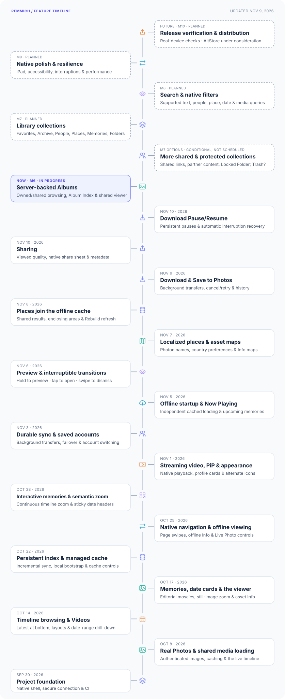

<b>Remmich</b>

 Your **re**ad-only I**mmich** library, native on iPhone and iPad.

 

  
  
  
  
  
  

Remmich is a SwiftUI, UIKit, and AVKit client for your self-hosted Immich library. Browse photos, watch videos, revisit memories, and keep thumbnails and asset information available offline without changing your server library.

**0.5.0 is an early release focused on Photos, Videos, and the media viewer.** Sharing, Download and Save to Photos are available. Albums, Search, and Library collections currently show demo data. The account and profile settings use your real Immich account.

See the **[Roadmap](#roadmap)** for upcoming features, remaining verification and the feature timeline from the project's first commit.

  

## Install

Requires an iPhone or iPad running iOS/iPadOS 26.6 or later and an account on your Immich server.

Download an optimized, unsigned IPA from [GitHub Releases](https://github.com/Ender-Wang/Remmich/releases) and install it with a compatible sideloading tool, such as AltStore Classic, which signs it using your Apple ID.

You can also follow [Build and run](CONTRIBUTING.md#build-and-run) to build from source. After installing, sign in with your Immich server address and credentials. Add a Primary address and optional Fallback addresses in **Profile → Connection** if needed.

## Features

- **🔍 Timelines:** Separate Photos and Videos timelines with pinch-to-zoom, date cards and saved browsing positions.
- **📸 Photos and memories:** Zoomable photos, Live Photo playback, filmstrip navigation and rotating memories.
- **👆 Quick preview:** Long-press to preview, tap to open, and swipe down to dismiss with interruptible transitions.
- **🗺️ Places and maps:** Photon landmarks, per-country language preferences and asset maps below Info.
- **🎬 Video:** Native playback, Picture in Picture and iOS Now Playing with titles and artwork.
- **💾 Offline browsing:** Cached timelines, thumbnails, asset information and place names, with background sync and cache controls.
- **📥 Downloads:** Save a quality tier to Photos → Remmich, with background transfers, pause/resume, automatic recovery, cancel/retry and history.
- **📤 Sharing:** Share the viewed quality from the viewer or preview, retaining supported metadata and cached image compression.
- **🔐 Accounts and connections:** Saved-account switching, separate account caches and Primary/Fallback server addresses.
- **✨ Native appearance:** Adaptive iPhone/iPad layouts, Liquid Glass, swipe navigation and alternate app icons.

## Current limitations

- **Live Photo sharing:** shares the still image. Native motion sharing is limited by the investigated Apple public APIs; automatic export is unavailable in this implementation, and the system picker requires another selection step. Save to Photos preserves Live Photos.
- **Sharing:** single-asset sharing only. Shared files currently retain available GPS metadata.
- **Offline originals:** thumbnail caching does not retain originals or playable videos; explicitly saved Photos resources can be reused when the requested quality matches.
- **Albums, Library collections, and Search:** these destinations currently show demo data. Server-backed browsing and search are planned.
- **Offline video:** saved Playback videos can load locally while the Photos resource remains accessible. Otherwise, streaming requires a reachable server.
- **Asset locations and maps:** maps require valid asset GPS and an enabled, compatible Immich map source. Place names and translated map labels depend on the provider's available data.

## Milestones

Milestones track implementation and help set expectations for upcoming work. **0.5.0 includes the implemented parts of M5; M5 remains in progress.** The [Roadmap](#roadmap) expands this summary with planned features and dated achievements.

| Milestone | Status | Scope and expectations |
| --- | --- | --- |
| M0 | ✅ Done | Reproducible Xcode project, formatting, and baseline configuration |
| M1 | ✅ Done | Adaptive native app shell and demo destinations |
| M2 | ✅ Done | Sign-in, Keychain restoration, endpoint failover, and the typed read-only API boundary |
| M3 | ✅ Done | Shared media loading, caching, prefetching, and bounded memory use |
| M4 | ✅ Done | Real server-backed Photos timeline |
| M5 | In progress | Timelines, viewers, preview, places/maps, Sharing and Download/Save to Photos are available; final verification remains |
| M6 | Planned | Server-backed read-only Albums browsing |
| M7 | Planned | Server-backed read-only Library collections |
| M8 | Planned | Server-backed Search with native filters |
| M9 | Planned | Further improvements and verification for iPad, accessibility, resilience, and performance |
| M10 | Planned | Broader real-device release verification and additional distribution options |

## Roadmap

Updated **November 10, 2026**. The timeline runs from future plans at the top, through **Now**, to older achievements below. Future work follows milestone order toward the present without invented dates; conditional options are grouped with their related milestone. Each completed milestone uses its latest implementation checkpoint date; related earlier work is included in its description and commit links. These are repository dates, not App Store availability or release dates. Implemented features may include local commits awaiting publication. Planned work has no promised delivery date.

### Now and next

| Priority | Feature | Status | Intended outcome |
| --- | --- | --- | --- |
| Now · M5 | Download Pause/Resume | Available | Retain manual pauses across relaunch and recover interrupted downloads automatically where supported. |
| M5 | Sharing | Available | Share the viewed tier with supported metadata; Live Photos share their still. |
| M5 | Download and Save to Photos | Available | Save selected quality to Photos → Remmich; background transfers, progress, cancel/retry and Downloads History. |
| M6 | Real Albums | Planned | Browse server-backed owned/shared albums and open their assets in the shared viewer. Albums currently shows demo data. |
| M7 | Library collections | Planned | Read-only Favorites, Archive, People, Places, Memories and Folders, according to server capabilities. Library collections currently use demo data; account/settings already use real data. |
| M8 | Search and filters | Planned | Server-backed search with supported people, place, date, media and camera filters. Search currently uses demo data. |
| M9 | Wider native polish and resilience | Planned | Broader iPad, accessibility, interruption, offline and performance coverage across the completed workflows. |
| M10 | Release verification and distribution | Planned | Broader real-device verification and sideloading distribution; AltStore remains under consideration. |

These are the current implementation priorities, not separate committed release versions. Shared links, partner content and Locked Folder need capability/authentication validation before inclusion; Trash browsing remains undecided. Uploading or modifying the Immich library is outside Remmich's read-only scope.

### Verification still open

- **Sharing:** Preview metadata-only copying is device-verified. Broader formats, destinations, iPad presentation and automated test coverage still need verification.
- **Downloads:** earlier Full-tier errors, broader format/Live Photo and background-relaunch cases still need verification. Pause/Resume controls and the restored byte-count handoff are device-verified; comprehensive interruption/relaunch coverage and new automated fixtures remain unverified. Partial-data reuse depends on iOS and server support; a download may restart when it cannot resume.
- **Custom Photon instance:** batch caching and explicit Cache Rebuild are implemented, but the maintainer has not yet run the NAS Rebuild end to end on a physical device. Public-server demand fetching and landmark names have device acceptance. The latest Rebuild [focused CI passed](https://github.com/Ender-Wang/Remmich/actions/runs/42461148263).
- **Release coverage:** broader devices, orientations, accessibility and network/interruption cases remain release checks. Feature implementation and the recorded device acceptance do not imply every release scenario has passed.

<strong>Timeline details and commit references</strong>

### Feature timeline

#### November 10, 2026 · Download Pause/Resume and recovery

Pause downloads and resume them later, retaining paused intent across relaunch. Transient interruptions retry automatically; reusable partial data is preserved where supported. Stable controls and progress remain visible, with elapsed time stopped during pauses and network waits. After a force-quit, reopen Remmich to recover downloads.

[Pause/Resume and recovery](https://github.com/Ender-Wang/Remmich/commit/91fd894)

#### November 10, 2026 · Sharing

Share the viewed quality from the viewer or long-press preview. Cached images keep their encoded source dimensions and compression; supported metadata is retained. Videos share Playback with audio; Live Photos share their still. Native motion sharing remains limited by the investigated Apple public APIs.

[Native sharing](https://github.com/Ender-Wang/Remmich/commit/f095e18)

#### November 9, 2026 · Download and Save to Photos

Save a selected quality from the viewer or preview to Photos → Remmich. Downloads continue in the background, with progress, cancel/retry and a compact Downloads History. Matching saved resources load locally. Originals preserve their bytes; reduced images and Playback videos restore supported metadata.

[Save to Photos](https://github.com/Ender-Wang/Remmich/commit/4edb755) · [Local reuse](https://github.com/Ender-Wang/Remmich/commit/45133b5) · [Download UX](https://github.com/Ender-Wang/Remmich/commit/810546d) · [Video metadata](https://github.com/Ender-Wang/Remmich/commit/b97a97b)

#### November 8, 2026 · Places join the offline cache

Photon place results now share the existing account metadata database, retry controls and copied-error report. Viewing an asset reads cached places first. Custom instances support automatic enrichment and explicit Rebuild refresh; the public service remains demand-only. A failed refresh retains a usable same-GPS name. Detail-first landmark names can include an enclosing park, garden or reserve.

[Cache integration](https://github.com/Ender-Wang/Remmich/commit/4f62646) · [Enclosing-area names](https://github.com/Ender-Wang/Remmich/commit/47a5bc9) · [Rebuild refresh](https://github.com/Ender-Wang/Remmich/commit/49d8399)

#### November 7, 2026 · Localized places and maps

Photon landmarks appear in the viewer header and Info. Account → Maps & Places offers a custom Photon URL and per-country English/Local preferences, defaulting to English. Pull Info up to reveal the asset's MapLibre map using the Immich basemap. Maps stay with their Info pages through scrolling and paging, with decimal GPS coordinates beside attribution controls. Local names and map labels depend on source coverage.

[Places, settings and maps](https://github.com/Ender-Wang/Remmich/commit/37ba357) · [Info-owned map lifecycle](https://github.com/Ender-Wang/Remmich/commit/1785dd9) · [GPS caption refinement, November 8](https://github.com/Ender-Wang/Remmich/commit/44a002b)

#### November 6, 2026 · Long-press preview and interruptible transitions

Hold a timeline asset to preview it; Live Photos and videos play once, muted. Tap the preview to expand into the full viewer. Swipe down, tap outside or use Back to dismiss. Opening and returning transitions allow interruption, immediate reopening and timeline scrolling while a returning image follows its cell. The preview action panel offers Share and Save to Photos.

[Preview](https://github.com/Ender-Wang/Remmich/commit/a2f296d) · [Shared transitions and tap-to-open](https://github.com/Ender-Wang/Remmich/commit/63f51a4) · [Swipe-down](https://github.com/Ender-Wang/Remmich/commit/66a5835) · [Interruption](https://github.com/Ender-Wang/Remmich/commit/c7c74d7) · [Scroll-following returns](https://github.com/Ender-Wang/Remmich/commit/02d8e45)

#### November 5, 2026 · Offline startup, memories and system playback

Cached thumbnails load independently of connection discovery. Memories check today and up to three upcoming days, with crossfading covers. Full-viewer video reports its title/artwork to Now Playing and restores inline playback when returning from PiP.

[Offline startup](https://github.com/Ender-Wang/Remmich/commit/45ed683) · [Upcoming memories](https://github.com/Ender-Wang/Remmich/commit/0ddb7c3) · [PiP restoration](https://github.com/Ender-Wang/Remmich/commit/2d9af5a) · [Now Playing artwork](https://github.com/Ender-Wang/Remmich/commit/2bec8f1)

#### November 3, 2026 · Durable sync and saved accounts

Library index, thumbnail and metadata work gains durable foreground/background transfers, subject to iOS scheduling. Primary/Fallback connection settings show response times. Switch saved accounts without signing in again while their sessions remain valid, retaining separate indexes, caches and settings. Landing/sign-in and profile progress controls are redesigned.

[Background sync](https://github.com/Ender-Wang/Remmich/commit/18af9c0) · [Durable transfers](https://github.com/Ender-Wang/Remmich/commit/e5b9c9c) · [Connection controls](https://github.com/Ender-Wang/Remmich/commit/30ad90c) · [Account switching](https://github.com/Ender-Wang/Remmich/commit/9b5b6b2)

#### November 1, 2026 · Streaming video, PiP and personal appearance

Authenticated byte-range streaming and a viewer-owned player replace the earlier video path. Native controls, buffering feedback and playback-paced loading support portrait/landscape viewing. Automatic Picture in Picture arrives November 1. Profile cards expand into settings; animated branding and alternate Home Screen icons add personal appearance choices.

[Streaming](https://github.com/Ender-Wang/Remmich/commit/a81e633) · [Playback session](https://github.com/Ender-Wang/Remmich/commit/b716ebc) · [Buffer pacing](https://github.com/Ender-Wang/Remmich/commit/897e2ee) · [PiP](https://github.com/Ender-Wang/Remmich/commit/cdb768e) · [Icons](https://github.com/Ender-Wang/Remmich/commit/dbdc905) · [Profile](https://github.com/Ender-Wang/Remmich/commit/ce422ab)

#### October 28, 2026 · Interactive memories and semantic zoom

An interactive memory viewer adds autoplay, paging and returning to the memory card. The shared Photos/Videos timeline gains continuous semantic zoom through Square, Natural, Day, Week, Month and Year, followed by sticky date headers and smoother visual handoffs.

[Memory viewer](https://github.com/Ender-Wang/Remmich/commit/05bcb55) · [Semantic zoom](https://github.com/Ender-Wang/Remmich/commit/4f845fc) · [Sticky dates](https://github.com/Ender-Wang/Remmich/commit/48fe412)

#### October 25, 2026 · Native navigation and richer offline viewing

Swipe between app pages and animate tab selections. Viewer Info becomes available offline alongside cached thumbnails; cache pause/thermal feedback, Live Photo sound controls and explicit full-resolution loading follow.

[Page swipes](https://github.com/Ender-Wang/Remmich/commit/5d3f9ce) · [Offline Info](https://github.com/Ender-Wang/Remmich/commit/c04b8e9) · [Pause](https://github.com/Ender-Wang/Remmich/commit/1506db8) · [Live Photo sound](https://github.com/Ender-Wang/Remmich/commit/d604e94) · [Full resolution](https://github.com/Ender-Wang/Remmich/commit/0fa7935)

#### October 22, 2026 · Persistent index and managed cache

An account-scoped SQLite index, incremental synchronization, thumbnail inventory and storage controls enable local timeline bootstrap. Later changes prioritize visible thumbnails and preserve timeline position through rotation.

[Persistent index](https://github.com/Ender-Wang/Remmich/commit/f45676c) · [Incremental sync](https://github.com/Ender-Wang/Remmich/commit/bdb715c) · [Cache management](https://github.com/Ender-Wang/Remmich/commit/81209f9) · [Local bootstrap](https://github.com/Ender-Wang/Remmich/commit/f140dcc) · [Visible-image priority](https://github.com/Ender-Wang/Remmich/commit/afd7a1f)

#### October 17, 2026 · Memories, editorial date cards and the viewer

Year-stacked memories, natural-aspect grids and editorial date-group mosaics join the timeline. A shared native asset pager adds still-image zoom, initial video playback and read-only asset information.

[Memory stacks](https://github.com/Ender-Wang/Remmich/commit/0e9e9d3) · [Date-card layouts](https://github.com/Ender-Wang/Remmich/commit/f200d3b) · [Viewer](https://github.com/Ender-Wang/Remmich/commit/c133a8b) · [Info](https://github.com/Ender-Wang/Remmich/commit/7608528)

#### October 14, 2026 · Timeline browsing and the Videos tab

Latest-at-bottom Photos, return-to-latest, saved layout preferences and date-range navigation establish the browsing model. Videos gains its own timeline, and date cards open directly into scoped asset grids. The original pinch implementation is later replaced by October's semantic zoom.

[Latest at bottom](https://github.com/Ender-Wang/Remmich/commit/d505b8b) · [Preferences](https://github.com/Ender-Wang/Remmich/commit/ebc3994) · [Videos](https://github.com/Ender-Wang/Remmich/commit/0764ac0) · [Date drill-down](https://github.com/Ender-Wang/Remmich/commit/9dbf5bc)

#### October 8, 2026 · Real Photos and shared media loading

Authenticated media loading, caching and prefetching support the server-backed Photos timeline. Route-aware state, Immich date variants and adaptive grid work establish the first real browsing milestone.

[Media pipeline](https://github.com/Ender-Wang/Remmich/commit/17f85e7) · [Photos timeline](https://github.com/Ender-Wang/Remmich/commit/9933d4d) · [Date variants](https://github.com/Ender-Wang/Remmich/commit/a28eba2)

#### September 30, 2026 · Project foundation

The project begins with a reproducible Xcode baseline, adaptive native shell and secure read-only Immich connection. Keychain session restoration, endpoint discovery/failover and continuous integration establish the foundation. Initial non-Photos destinations use fixture data.

[First commit](https://github.com/Ender-Wang/Remmich/commit/8f0049f) · [Native shell](https://github.com/Ender-Wang/Remmich/commit/52eb1ae) · [Connection foundation](https://github.com/Ender-Wang/Remmich/commit/b3c2737) · [Endpoint switching](https://github.com/Ender-Wang/Remmich/commit/9fa7860)

## Read-only by design

Remmich does not upload, edit, archive, favorite, or delete Immich assets. Saved sign-in sessions are stored in Keychain, and local indexes and media caches are scoped to the account. Cache maintenance changes device data only.

Sharing, Download and Save to Photos operate on local copies without changing the Immich server's library.

## Dependencies

Remmich connects to [Immich](https://github.com/immich-app/immich) through the local [ImmichAPI package](Packages/ImmichAPI), generated from Immich's OpenAPI schema.

| Library | Resolved version | Purpose |
| --- | --- | --- |
| [Nuke / NukeUI](https://github.com/kean/Nuke) | 13.2.2 | Image loading, caching, prefetching, and SwiftUI image views |
| [MapLibre Native](https://github.com/maplibre/maplibre-gl-native-distribution) | 7.0.0 | Native asset maps using Immich's configured styles |
| [Swift OpenAPI Runtime](https://github.com/apple/swift-openapi-runtime) | 1.12.1 | Runtime support for the generated API client |
| [Swift OpenAPI URLSession](https://github.com/apple/swift-openapi-urlsession) | 1.3.1 | URLSession transport for API requests |
| [Swift HTTP Types](https://github.com/apple/swift-http-types) | 1.8.0 | HTTP request, response, and header types |

Build and development tools:

- [Swift OpenAPI Generator](https://github.com/apple/swift-openapi-generator) **1.13.1** generates the client during the build.
- [SwiftFormat](https://github.com/nicklockwood/SwiftFormat) checks source formatting. CI uses the latest release; no specific version is required locally.
- Artwork regeneration uses **Python 3** and **librsvg's `rsvg-convert`**; see [Schema and artwork updates](CONTRIBUTING.md#schema-and-artwork-updates).

Swift packages resolve through Xcode. The [app lockfile](Remmich.xcodeproj/project.xcworkspace/xcshareddata/swiftpm/Package.resolved) and [API package lockfile](Packages/ImmichAPI/Package.resolved) record the complete resolved dependency graph, including transitive packages. SwiftUI, UIKit, AVKit/AVFoundation, and SQLite are provided by the operating system.

## Contributing

See [CONTRIBUTING.md](CONTRIBUTING.md) for development setup, architecture, the source layout, key implementation patterns, testing, and schema/artwork generation.

## License

[GNU GPLv3](LICENSE).
