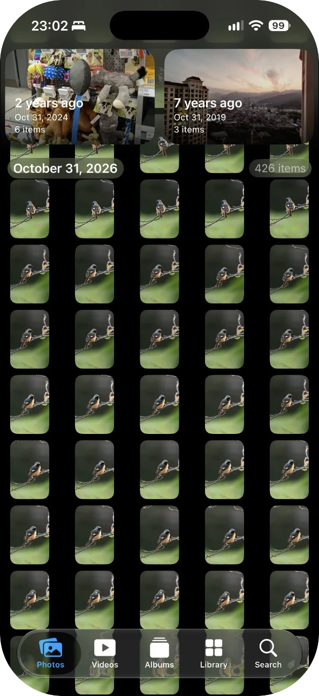
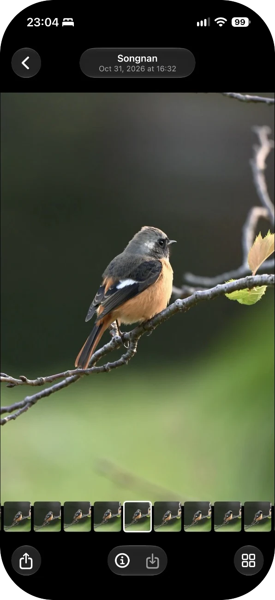
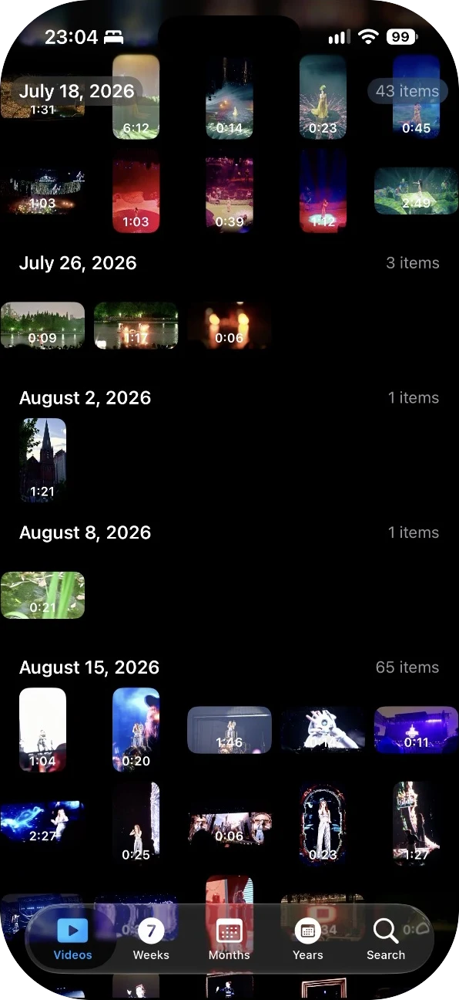
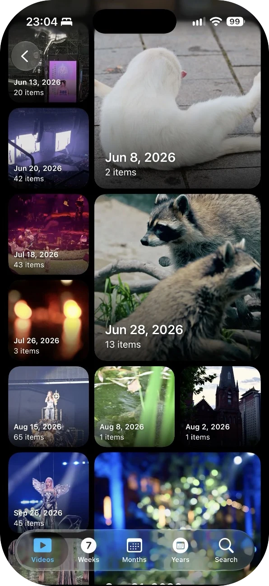
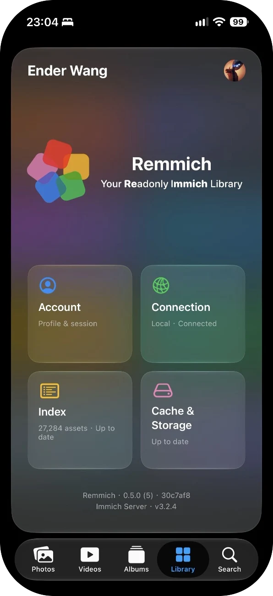

<b>Remmich</b>

 Your **re**ad-only I**mmich** library, native on iPhone and iPad.

 

  
  
  
  
  
  

Remmich is a SwiftUI, UIKit, and AVKit client for your self-hosted Immich library. Browse photos, watch videos, revisit memories, and keep thumbnails and asset information available offline without changing your server library.

**0.5.0 is an early release focused on Photos, Videos, and the media viewer.** Save to Photos, Share/Export, and Download are still in development. Albums, Search, and Library collections currently show demo data. The account and profile settings use your real Immich account.

  
  
  
  
  
   
  Photos timeline · Photo viewer · Videos timeline · Video cards · Profile

## Install

Requires an iPhone or iPad running iOS/iPadOS 26.6 or later and an account on your Immich server.

CI-built IPA downloads for sideloading are planned for a later update, with AltStore as a possible installation option.

For now, follow [Build and run](CONTRIBUTING.md#build-and-run) to build from source. After installing, sign in with your Immich server address and credentials. Add Local and External addresses in **Profile → Connection** if needed.

## Features

### 🔍 Semantic zoom and date cards

- Pinch through **Square → Natural → Days → Weeks → Months → Years**.
- Photos and date cards move and resize with the gesture, keeping your place as you zoom between individual photos and yearly overviews.
- Browse date cards with large cover images; tap one to open that period directly, then return to your place in the timeline.
- Browse separate Photos and Videos timelines, with refresh, retry, and scroll-position restoration.

### 📸 Photos and memories

- View photos with zoom, Live Photo motion playback, and detailed asset information.
- Revisit memories above both the Photos and Videos timelines.
- Swipe through memory items and continue to the previous or next memory in the viewer.

### 🎬 Video playback

- Open the selected video in AVKit using authenticated HTTP byte-range streaming.
- Play, pause, and seek in portrait and landscape layouts, with visible buffering status.
- Double-tap the video to play or pause; single-tap to show or hide playback controls.
- See an animated loading logo from the opening transition until the first video frame. It fades in during preparation and fades out when playback is ready.

### 👆 Navigation and appearance

- Swipe left or right between the app's main pages and through photos and memory items in the viewer.
- Swipe inward from the left screen edge to go Back or dismiss the current app-owned presentation.
- Return to the page you came from with Back, including **Account → Connection → Account**.
- Use adaptive layouts, Liquid Glass, and profile cards that expand into their pages and shrink back on return.
- Touch and hold the profile logo to choose **Spiral**, **Spaced**, or **Mosaic** as your Home Screen icon. In-app branding follows the selected icon and respects Reduce Motion.

### 💾 Offline browsing and storage

- Keep a local timeline index, cached thumbnails, and cached asset information for offline browsing.
- Enable automatic thumbnail and metadata caching.
- Monitor sync progress, pause or resume work, retry failures, inspect diagnostics, and manage local caches from **Index** and **Cache & Storage**.

### 🔐 Account and connection

- Restore your sign-in session from Keychain when you reopen the app.
- Configure Local and External server addresses, with endpoint validation, failover, and visible connection status.
- Manage Account, Connection, Index, and Cache & Storage from the profile panel opened through your avatar.

## Current limitations

- **Local originals and export:** Save to Photos, Share/Export, and Download are still in development; their viewer controls are disabled. Thumbnail caching does not retain original photos or playable videos.
- **Albums, Library collections, and Search:** these destinations currently show demo data. Server-backed browsing and search are planned.
- **Offline video:** cached posters and asset information can be viewed offline; video playback requires a reachable server.
- **Map browsing:** a map-based location view is still planned.

## Milestones

Milestones track implementation and help set expectations for upcoming work. **0.5.0 includes the implemented parts of M5; M5 remains in progress.**

| Milestone | Status | Scope and expectations |
| --- | --- | --- |
| M0 | ✅ Done | Reproducible Xcode project, formatting, and baseline configuration |
| M1 | ✅ Done | Adaptive native app shell and demo destinations |
| M2 | ✅ Done | Sign-in, Keychain restoration, endpoint failover, and the typed read-only API boundary |
| M3 | ✅ Done | Shared media loading, caching, prefetching, and bounded memory use |
| M4 | ✅ Done | Real server-backed Photos timeline |
| M5 | In progress | Semantic zoom, date cards, memories, Videos, and viewers are implemented; map browsing, Save/Share/Download, and final verification remain |
| M6 | Planned | Server-backed read-only Albums browsing |
| M7 | Planned | Server-backed read-only Library collections |
| M8 | Planned | Server-backed Search with native filters |
| M9 | Planned | Further improvements and verification for iPad, accessibility, resilience, and performance |
| M10 | Planned | Broader real-device release verification, CI-built IPAs, and sideloading distribution; AltStore is under consideration |

## Read-only by design

Remmich does not upload, edit, archive, favorite, or delete Immich assets. Saved sign-in sessions are stored in Keychain, and local indexes and media caches are scoped to the account. Cache maintenance changes device data only.

Future Save, Share, and Download actions will operate on local copies. They will not change the Immich server's library.

## Contributing

See [CONTRIBUTING.md](CONTRIBUTING.md) for development setup, architecture, the source layout, key implementation patterns, testing, and schema/artwork generation.

## License

[GNU GPLv3](LICENSE).
